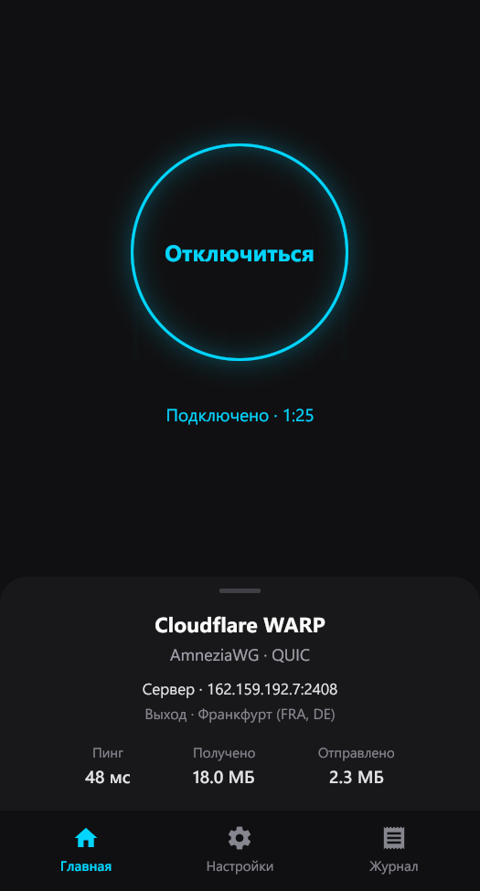
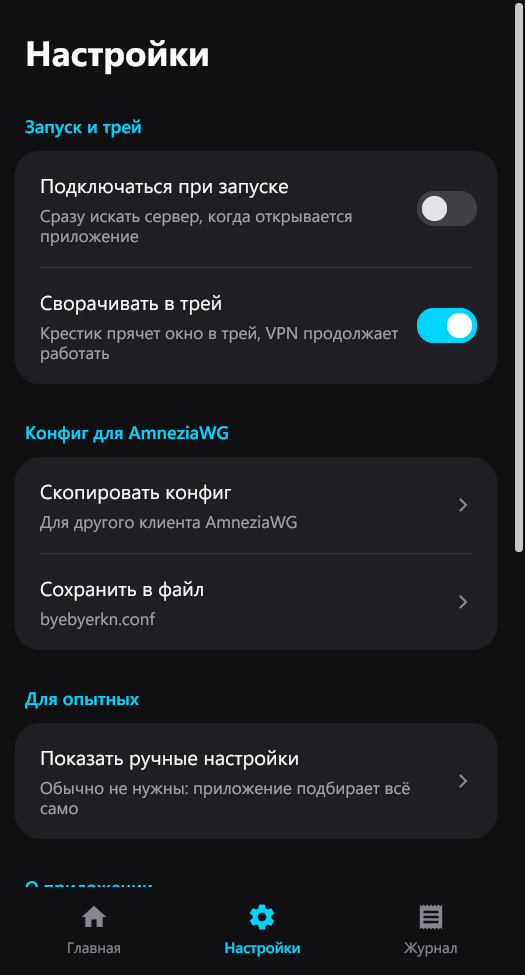
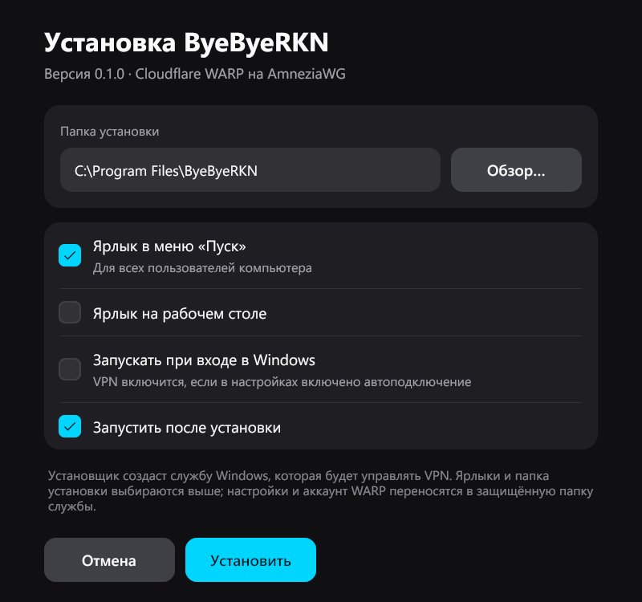

# ByeByeRKN для Windows

**0.1.0 alpha** — первый релиз Windows-порта [Android-приложения ByeByeRKN](https://github.com/alexus282/ByeByeRKN).
Клиент Cloudflare WARP на AmneziaWG с обычным окном, иконкой в трее и службой Windows.

Код на Go, ядро туннеля — `github.com/amnezia-vpn/amneziawg-go`, интерфейс — `gioui.org`
(собственная отрисовка, D3D11, CGO не нужен). Оформление повторяет Android-приложение в стиле
Amnezia: тёмные поверхности, бирюзовый акцент, светящееся кольцо подключения, карточки настроек и
нижняя навигация.





## Что умеет

- регистрирует устройство в WARP теми же вызовами, что и официальный клиент (`POST reg`, `PATCH reg/{id}`);
- сканирует эндпоинты настоящими handshake-пробами и подбирает маскировку (QUIC, STUN, LIGHT, DNS,
  SIP, HEAVY, NONE) в том же порядке, что и Android;
- поднимает Wintun-адаптер, адреса, MTU, DNS и маршруты; до сервера WARP добавляет отдельный
  маршрут через физический интерфейс, иначе туннель завернул бы сам себя;
- проверяет, что трафик действительно идёт через WARP (`https://1.1.1.1/cdn-cgi/trace`), и при
  handshake без трафика пробует MTU 1280 → 1200 → 1100;
- не делает дополнительных проверок Telegram: маршрут считается рабочим, когда трафик реально
  прошёл через WARP. Приблизительная локация выхода Cloudflare (`colo`) показывается только как
  справка и не влияет на вердикт;
- в карточке сервера отдельно показаны настоящий адрес WARP-эндпоинта, к которому подключён
  туннель, и приблизительный выход Cloudflare (город и код `colo`);
- следит за сессией по счётчикам и времени handshake, при зависании переподключается;
- настройки: маскировка, DNS, ручной эндпоинт, QUIC SNI, WARP+ ключ, автоподключение;
- «Скопировать конфиг» отдаёт текущую сессию в формате wg-quick для другого AmneziaWG-клиента,
  «Сохранить в файл» — тот же конфиг через стандартный диалог Windows;
- живёт в трее: меню «Подключиться/Отключиться», «Открыть», «Выход», состояние в подсказке;
  крестик по умолчанию прячет окно в трей, поведение переключается в настройках;
- один экземпляр: повторный запуск показывает уже работающее окно;
- служба Windows владеет туннелем: после установки окно работает **без прав администратора**;
- portable-режим: без установленной службы приложение, запущенное от администратора, управляет
  туннелем само.

Пока нет: MASQUE, раздельного туннелирования по приложениям, мониторинга качества выхода.

## Установка

Запустите `ByeByeRKN-Setup.exe` и подтвердите UAC один раз. Мастер установки спрашивает:

- **папку установки** (по умолчанию `%ProgramFiles%\ByeByeRKN`, можно выбрать другую через «Обзор…»;
  при обновлении подставляется папка прошлой установки);
- **ярлык в меню «Пуск»** (включён по умолчанию, для всех пользователей);
- **ярлык на рабочем столе** (по умолчанию выключен);
- **запуск окна при входе в Windows** (по умолчанию выключен; VPN подключится, если в настройках
  приложения включено автоподключение);
- **запуск приложения после установки** (включён по умолчанию).

Дальше установщик останавливает прежнюю службу и закрывает запущенное окно, копирует
`ByeByeRKN.exe` и `wintun.dll` в выбранную папку, переносит настройки из `%AppData%\ByeByeRKN` в
`%ProgramData%\ByeByeRKN` (если там ещё пусто), создаёт автоматическую службу `ByeByeRKN`
(LocalSystem) и выбранные ярлыки, добавляет запись в «Программы и компоненты».

Служба видна в `services.msc`, её журнал лежит в `%ProgramData%\ByeByeRKN\service.log` и
`service-error.log`. Удаление — из «Программ и компонентов»; оно останавливает службу, снимает
маршруты и удаляет настройки вместе с аккаунтом WARP.

Те же действия без мастера:

```powershell
.\ByeByeRKN.exe --install --dir "D:\Apps\ByeByeRKN" --desktop
.\ByeByeRKN.exe --install --no-start-menu --autostart
.\ByeByeRKN.exe --uninstall
```

`--install` по умолчанию ставит ярлык в «Пуск»; `--quiet` убирает вопросы и сообщает об ошибке
кодом возврата.

## Требования

- Windows 10/11 x64;
- для установки — права администратора; после неё окно работает без них;
- `wintun.dll` рядом с exe (сборка и установщик копируют её автоматически).

## Сборка

```powershell
.\build.ps1
```

Результат:

```text
dist\ByeByeRKN.exe
dist\wintun.dll
dist\ByeByeRKN-Setup.exe
```

Скрипт берёт версию из `VERSION`, собирает окно и однофайловый установщик, встраивая программу и
DLL в `cmd\setup\payload`. Нужен Go 1.26.10 или новее в PATH; `build.ps1` также находит локальную
установку в `C:\android\go\bin\go.exe`.

Вручную:

```powershell
go build -trimpath -ldflags "-H windowsgui -s -w" -o dist\ByeByeRKN.exe .
copy wintun\amd64\wintun.dll dist\
```

Иконка и манифест окна уже встроены через `ui\rsrc_windows_amd64.syso`. Пересоздать их:

```powershell
python make_icon.py
go run github.com/akavel/rsrc@v0.10.2 -ico winres\app.ico -manifest app.manifest -o ui\rsrc_windows_amd64.syso
go run github.com/akavel/rsrc@v0.10.2 -ico winres\app.ico -o cmd\setup\rsrc_windows_amd64.syso
```

## Тесты

```powershell
go vet ./...
go test ./... -count=1
```

Сетевая обвязка тестируется на подменённом исполнителе команд, поэтому прав администратора не
нужно. Реальный запуск туннеля проверяется вручную, от администратора.

Экраны проверяются без окна: `ui_test.go` и `cmd/setup/ui_test.go` рисуют их через headless-бэкенд
Gio. Чтобы посмотреть результат, укажите папку для PNG:

```powershell
$env:BBR_SCREENSHOTS="$env:TEMP\bbr"; go test ./ui/ ./cmd/setup/
```

Если GPU в системе недоступен, тесты пропускаются.

## Структура

| Пакет       | Что делает |
|-------------|------------|
| `awg`       | пресеты обфускации, I1 (QUIC/STUN/DNS/SIP) |
| `catalog`   | адреса и порты WARP, подписанный каталог из репозитория |
| `probe`     | handshake-пробы и параллельный сканер эндпоинтов |
| `warp`      | регистрация устройства, WARP+, split ClientHello |
| `wintunnel` | netsh/PowerShell: адреса, MTU, DNS, маршруты, откат |
| `engine`    | контроллер: поиск, подключение, проверка трафика, монитор |
| `store`     | настройки и удачный маршрут: `%AppData%` в portable, `%ProgramData%` у службы |
| `ui`        | окно на Gio: главная, настройки, журнал, диалоги |
| `control`   | JSON-over-named-pipe: сервер в службе и клиент для окна |
| `winsvc`    | хост службы: приём команд SCM, запуск и остановка сервера |
| `install`   | установка/удаление: файлы, служба, ACL, ярлыки, запись удаления |
| `cmd/setup` | мастер установки на Gio и однофайловый Setup.exe |
| `tray`      | значок и меню в области уведомлений, выход из системы |
| `instance`  | один экземпляр, события «показать окно» и «закрыться для удаления» |
| `winres`    | иконка и её исходник |
| `wintun`    | официальная `wintun.dll` и лицензия |

## Как это устроено

Служба `ByeByeRKN` (LocalSystem, автозапуск) владеет движком, настройками и WARP-аккаунтом. Окно
запускается обычным пользователем и общается со службой по `\\.\pipe\ByeByeRKN`: JSON-команды
`connect`, `disconnect`, `settings`, `export`, `warp-plus`, `forget-server`, `reset-account`;
обратно идут `status`, `traffic`, `log`, `settings`, `account`. Pipe доступен только установившему
пользователю, SYSTEM и администраторам.

Если служба перезапустилась (обновление, восстановление после сбоя), окно само переподключается к
pipe и продолжает показывать состояние. Настройки службы лежат в защищённой папке
`%ProgramData%\ByeByeRKN`; portable-режим пишет в `%AppData%\ByeByeRKN`.

## Важно про маршруты

Приложение добавляет маршруты `0.0.0.0/1`, `128.0.0.0/1`, `::/1` и `8000::/1` через свой адаптер и
снимает их при отключении, при выходе из трея и при завершении сеанса Windows. Пары `/1` покрывают
весь диапазон адресов, но имеют приоритет над default route другого VPN. Если процесс убить
принудительно (диспетчер задач), откат не выполнится; в этом случае удалите маршруты вручную:

```powershell
netsh interface ipv4 delete route 0.0.0.0/1 ByeByeRKN
netsh interface ipv4 delete route 128.0.0.0/1 ByeByeRKN
netsh interface ipv6 delete route ::/1 ByeByeRKN
netsh interface ipv6 delete route 8000::/1 ByeByeRKN
netsh interface ipv4 set dnsservers name=ByeByeRKN source=dhcp
netsh interface ipv6 set dnsservers name=ByeByeRKN source=dhcp
```

## Ограничения 0.1.0

- **MASQUE отсутствует.** Если AmneziaWG-выход перестанет работать, альтернативного транспорта
  в этой версии нет.
- **Установщик и exe не подписаны.** SmartScreen может показать предупреждение.
- **Одна служба на машину.** WARP-аккаунт и настройки общие для всех пользователей; окно пускает
  установившего пользователя (SID в `%ProgramData%\ByeByeRKN\client.sid`).
- **Поддержка AmneziaWG 3.1** пока не включена: используется `amneziawg-go` v1.0.4 с параметрами,
  которых достаточно для Cloudflare WARP. Апгрейд на `/v3` запланирован.
- Принудительное завершение процесса из диспетчера задач не даёт снять маршруты; служба корректно
  обрабатывает Stop/Shutdown, но не `TerminateProcess`.

## Лицензия

[Apache License 2.0](LICENSE). `wintun.dll` распространяется по своей лицензии —
см. `wintun\LICENSE.txt`. Проект не связан с Cloudflare; WARP — сервис Cloudflare, Inc.
